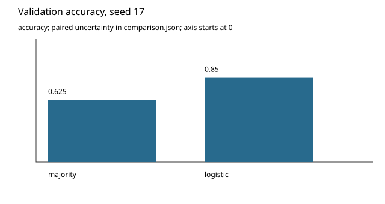

# Can we trust the experiment we meant to run? (internal draft)

A small synthetic sensor study illustrates a common research risk: configuration can describe one run while a trainer executes another. We compared a majority baseline and a one-feature classifier on the same validation groups. The source-linked outcomes and uncertainty are in summary.md and ablation-review.md.

The plot shows actual validation accuracies; the paired group-bootstrap interval is in comparison.json. This is one seed, not proof of robust improvement. An injected optimizer override and a deliberately false reported metric both failed verification. Their original records remain available, so a returning researcher can distinguish invalid execution from a rejected scientific hypothesis.

The useful result is a reproducible workflow: preserve intent, observe execution, check output artifacts, and carry bounded conclusions into the handoff. See handoff.md for exact reproduction instructions and failure-analysis.md for the remaining scientific questions.
